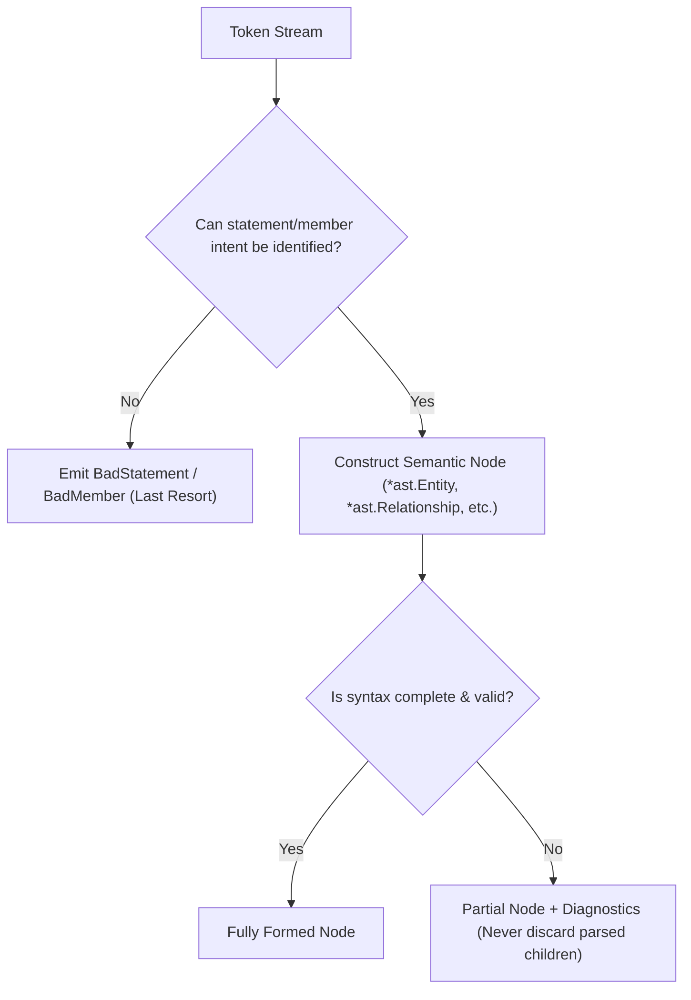
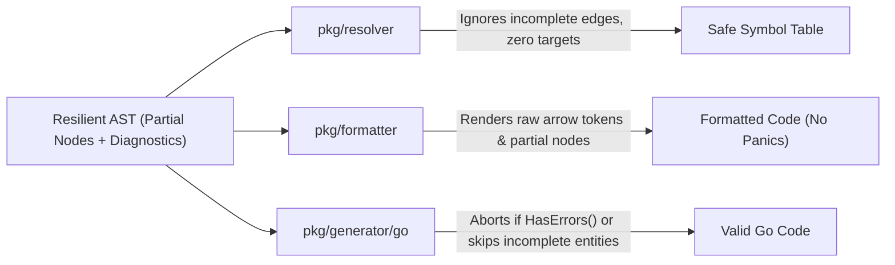
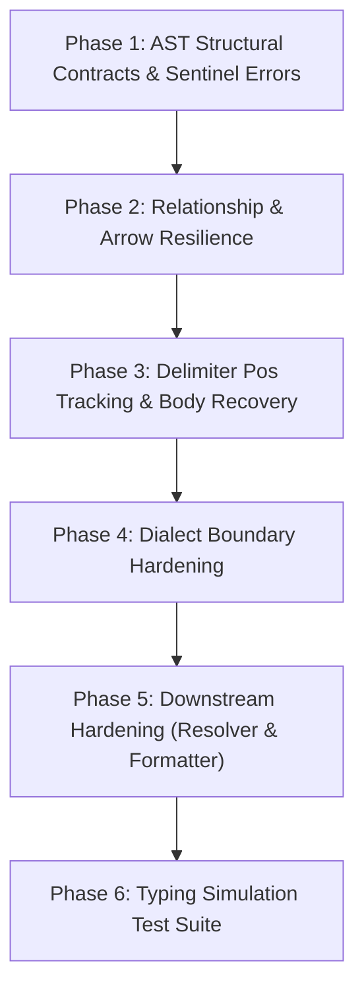

# Parser Resilience & Intermediary Typing States Roadmap

Technical specification and implementation roadmap for making the PlantUML parser resilient against incomplete, in-flight, and malformed syntax.

---

## 1. Core Architectural Principle: Semantic-First, BadStatement Last-Resort

`BadStatement` and `BadMember` must be strictly reserved for unidentifiable tokens (e.g. stray random punctuation, unsupported preprocessor garbage). Once the parser can determine the syntactic intent of a statement or member, it must construct the corresponding semantic AST node, representing incomplete, malformed, or missing components via structural zero-values, delimiter positions (`tokenizer.Pos`), and attached diagnostics.



### Invariants

1. **Deterministic Classification:** Once an entity keyword, container keyword, note keyword, or relationship arrow prefix is encountered, the construct is committed to that AST type. It never demotes to `BadStatement`.
2. **Lossless Intermediary State:** Typing-in-progress code (e.g., `class Foo <`, `User --> `, `A : +field`) must produce usable AST nodes with exact source spans and diagnostics pointing to the expected completion.
3. **No AST Dropping on EOF:** Unclosed delimiters (`{`, `<`, `<<`, `"`, `(`, `/*`) at EOF must close the enclosing semantic node and record a diagnostic, never discarding inner members or statements.
4. **No Redundant Boolean Flags:** Incompletion and block closure states are derived from natural zero-values (`Ident.IsZero()`, `TargetRef.IsZero()`), delimiter positions (`RBrace == tokenizer.Pos{}`), and the diagnostic list. No boolean flags are stored in AST structs.
5. **Memory Efficiency via `tokenizer.Pos`:** Delimiter brackets (`{` and `}`) are single characters; their presence and source offset are tracked via lightweight `tokenizer.Pos` rather than 6-word `SourceSpan` structs.
6. **Downstream Immunity:** `pkg/resolver`, `pkg/formatter`, and `pkg/generator` must gracefully handle partial nodes without panics, nil pointer dereferences, or empty-string symbol pollution.

---

## 2. Diagnostics & Sentinel Error Architecture

### 2.1 Consolidated Sentinel Catalog

Syntax errors in the core parser are classified using a minimal, non-redundant set of sentinel errors:

```go
var (
    ErrUnclosedBlock         = errors.New("unclosed block")
    ErrMissingIdentifier     = errors.New("expected identifier")
    ErrIncompletePackagePath = errors.New("incomplete qualified package path")
    ErrMissingTarget         = errors.New("expected relationship target")
    ErrMalformedArrow        = errors.New("malformed relationship arrow")
)
```

Contextual details are provided by wrapping the sentinel:
```go
// class \n -> "expected identifier after 'class'"
fmt.Errorf("%w after %s", ErrMissingIdentifier, kwTok.Literal)
```

### 2.2 Unified `UnclosedBlockError` Constructor

PlantUML uses numerous block delimiters across diagrams:
- `{ ... }` (entities, containers, skinparam)
- `<style> ... </style>`
- `<keyword> ... end <keyword>` / `end<keyword>` (`legend`, `title`, `header`, `footer`, `note`, `box`)

Instead of defining dozens of distinct sentinel errors, a single constructor wraps `ErrUnclosedBlock`:

```go
type UnclosedBlockError struct {
    BlockName      string // e.g. "class", "package", "legend", "note", "style"
    ExpectedCloser string // e.g. "}", "end legend", "end note", "</style>"
}

func (e *UnclosedBlockError) Error() string {
    return fmt.Sprintf("unclosed %s: expected %q", e.BlockName, e.ExpectedCloser)
}

func (e *UnclosedBlockError) Unwrap() error {
    return ErrUnclosedBlock
}

func NewUnclosedBlockError(blockName, expectedCloser string) error {
    return &UnclosedBlockError{
        BlockName:      blockName,
        ExpectedCloser: expectedCloser,
    }
}
```

Any downstream pass can match `errors.Is(diag, parser.ErrUnclosedBlock)` uniformly.

---

## 3. Intermediary Typing States Taxonomy

During interactive editing, code exists almost continuously in an intermediary or broken state. The parser must anticipate every keystroke progression:

```
Typing Progression Example:
1. "class"              -> *ast.Entity (Kind: Class, Identifier: zero)
2. "class User"         -> *ast.Entity (Kind: Class, Identifier: "User")
3. "class User <"       -> *ast.Entity (Generic: unclosed, expecting type param)
4. "class User <T>"     -> *ast.Entity (Generic: [T])
5. "class User <T> {"   -> *ast.Entity (LBrace: pos, RBrace: zero, Members: [])
6. "  +id"              -> *ast.FieldDeclaration (Name: "id", Type: nil/unspecified)
7. "  +id string"       -> *ast.FieldDeclaration (Name: "id", Type: "string")
8. "}"                  -> *ast.Entity (RBrace: pos)
```

---

## 4. Grammatical Resilience by Construct

### 4.1 Relationships & Arrow Expressions (`pkg/parser/parse_relationship.go`)

Relationships represent diagram edges. Malformed arrows, incomplete directions, or missing targets must **never** degrade into `BadStatement`.

```
Intermediary States:
- "A -"               -> Relationship (LHS: A, Arrow: partial "-", RHS: zero)
- "A --"              -> Relationship (LHS: A, Arrow: partial "--", RHS: zero)
- "A -->"             -> Relationship (LHS: A, Arrow: "-->", RHS: zero)
- "A --> "            -> Relationship (LHS: A, Arrow: "-->", RHS: zero)
- "A -[#red"          -> Relationship (LHS: A, Arrow: unclosed bracket/color, RHS: zero)
- "A -left-> B"       -> Relationship (LHS: A, Arrow: "->", Direction: Left, RHS: B)
- "A -unknown- B"     -> Relationship (LHS: A, MalformedArrow: "-unknown-", RHS: B)
- "A \"1\" --> \"*\"" -> Relationship (LHS: A, MultLHS: "1", Arrow: "-->", MultRHS: "*", RHS: zero)
- "A --> B : "        -> Relationship (LHS: A, Arrow: "-->", RHS: B, Label: empty/in-progress)
```

#### AST Representation

```go
type Relationship struct {
    LHS         TargetRef
    MultLHS     Cardinality
    LArrow      rune
    RArrow      rune
    Body        rune
    ArrowSpan   tokenizer.SourceSpan `json:",omitempty"` // Exact source span of the arrow (including invalid/in-flight)
    Direction   DirectionKind
    Color       string
    LineStyle   LineStyleKind
    MultRHS     Cardinality
    RHS         TargetRef         // Zero-value TargetRef when incomplete
    Label       string
    BaseNode
}

// IsIncomplete reports whether either endpoint is missing (derived predicate, no struct flag).
func (r *Relationship) IsIncomplete() bool {
    return r.RHS.Name.IsZero() || r.LHS.Name.IsZero()
}
```

#### Parser Recovery Behavior
1. **LHS Disambiguation:** In `disambiguateIdent`, if an identifier is followed by any arrow start token (`-`, `.`, `<`, `*`, `o`, `(`, `+`, `#`), immediately route to `parseRelationship`.
2. **Arrow Parsing:** Consume tokens until an identifier, string, newline, or EOF is met. Record the full span of consumed arrow tokens in `rel.ArrowSpan`. If arrow tokens do not form a standard PlantUML arrow (e.g. `-???->` or `-[`), record a diagnostic wrapping `ErrMalformedArrow`. Do not abort.
3. **Missing RHS:** If newline or EOF is reached where RHS is expected, leave `rel.RHS` as zero-value `ast.TargetRef{}`, emit diagnostic wrapping `ErrMissingTarget`, and synchronize to the next statement.
4. **Trailing Label:** If a colon `:` is followed by newline or EOF, store empty `Label`.

---

### 4.2 Entities (`pkg/parser/parse_entity.go`)

Entity declarations define classes, interfaces, enums, structs, and records.

```
Intermediary States:
- "class"                   -> Entity (Kind: Class, Identifier: zero, LBrace: zero)
- "class User"              -> Entity (Kind: Class, Identifier: "User", LBrace: zero)
- "class User as"           -> Entity (Identifier: "User", Alias: zero)
- "class \"Display\" as "   -> Entity (Name: "Display", Alias: zero)
- "class User <"            -> Entity (Identifier: "User", Generic: unclosed)
- "class User <<Entity"     -> Entity (Identifier: "User", Stereotype: unclosed)
- "class User #"            -> Entity (Identifier: "User", Color: unclosed/missing)
- "class User {\n"          -> Entity (Identifier: "User", LBrace: pos, RBrace: zero, Members: [])
- "class User {\n  ...\nEOF"-> Entity (Identifier: "User", LBrace: pos, RBrace: zero, Members: [...])
```

#### AST Structure

```go
type Entity struct {
    Kind       EntityKind
    Identifier TargetRef
    Alias      Ident
    Generic    *Generic
    Stereotype *Stereotype
    Tags       []string
    Color      string
    Members    []Member
    LBrace     tokenizer.Pos `json:",omitempty"` // Zero if bodyless declaration
    RBrace     tokenizer.Pos `json:",omitempty"` // Zero if unclosed before EOF
    BaseNode
}

// HasBody reports whether a block body was declared.
func (e *Entity) HasBody() bool { return e.LBrace != tokenizer.Pos{} }

// IsClosed reports whether an opened body has a matching closing brace.
func (e *Entity) IsClosed() bool { return !e.HasBody() || e.RBrace != tokenizer.Pos{} }
```

#### Parser Recovery Behavior
1. **Missing Name:** If keyword (`class`) is followed by `{` or newline, create `*ast.Entity` with a synthetic empty `TargetRef`, emit `ErrMissingIdentifier`, and proceed to parse body if `{` is present.
2. **Unclosed Generics (`<...`):** Consume until `>`, `{`, newline, or EOF. If generic delimiter is missing, record diagnostic, attach recovered type parameter identifiers to `ent.Generic`, and continue header parsing.
3. **Unclosed Stereotype (`<<...`):** Consume until `>>`, `{`, newline, or EOF. Record diagnostic, retain recovered stereotype string/spot.
4. **Unclosed Body:** When EOF is reached inside `{ ... }`, **do not return nil**. Leave `ent.RBrace` as zero `tokenizer.Pos{}`, emit `NewUnclosedBlockError("class", "}")`, and return `ent` with all parsed members.

---

### 4.3 Entity Members & Dialect Syntax (`pkg/parser/dialect/`)

Members are parsed inside entity bodies or as inline members (`Target : Member`). PlantUML grammar is inherently lenient regarding member syntax.

```
Intermediary States:
- "+"                   -> FieldDeclaration (Visibility: Public, Field: in-progress)
- "+name"               -> FieldDeclaration (Visibility: Public, FieldName: "name", FieldType: zero)
- "+getName("           -> MethodDeclaration (MethodName: "getName", Params: in-progress)
- "--"                  -> ClassSeparator (Type: '-', Label: empty)
- "== Section"          -> ClassSeparator (Type: '=', Label: "Section")
- "!@#$ garbage"        -> BadMember (Tokens: collected, Diagnostic attached)
```

#### Separation of Concerns: Core Parser vs Structured Dialects
- **Lenient Core Parser / LaxDialect:** In the core parser and `LaxDialect`, member sketch text is accepted as-is without requiring type or parameter syntax. Lines are only classified as `BadMember` if their tokens cannot be classified into any visibility, identifier, method, or separator pattern.
- **Strict Dialect Diagnostics:** Only structured dialects (such as `GoDialect`) that enforce target-language compilation rules are responsible for reporting dialect-specific member syntax errors (e.g. invalid Go type expression).

---

### 4.4 Containers (`pkg/parser/parse_container.go`)

Containers define packages, namespaces, and logical groupings (`package`, `namespace`, `together`, `folder`, `frame`, etc.).

```
Intermediary States:
- "package"               -> Container (Identifier: zero, LBrace: zero, Statements: [])
- "package foo."          -> Container (Identifier: partial "foo.", expecting segment)
- "package foo {"         -> Container (Identifier: "foo", LBrace: pos, RBrace: zero, Statements: [])
- "package foo {\n ...EOF"-> Container (Identifier: "foo", LBrace: pos, RBrace: zero, Statements: [...])
```

#### AST Structure

```go
type Container struct {
    Kind       ContainerKind
    Identifier TargetRef
    Alias      Ident
    Stereotype *Stereotype
    Tags       []string
    Color      string
    Statements []Statement
    LBrace     tokenizer.Pos `json:",omitempty"` // Zero if bodyless
    RBrace     tokenizer.Pos `json:",omitempty"` // Zero if unclosed before EOF
    BaseNode
}

func (c *Container) HasBody() bool  { return c.LBrace != tokenizer.Pos{} }
func (c *Container) IsClosed() bool { return !c.HasBody() || c.RBrace != tokenizer.Pos{} }
```

#### Parser Recovery Behavior
1. **Incomplete Qualified Path:** `package foo.` followed by `{` or newline captures `foo` as package path segment, emits `ErrIncompletePackagePath`, and continues.
2. **Missing Name:** `package {` creates an anonymous container, records `ErrMissingIdentifier`, and parses child statements.
3. **Unclosed Container:** On reaching EOF before `}`, close container, leave `container.RBrace` as zero `tokenizer.Pos{}`, emit `NewUnclosedBlockError("package", "}")`, and return `container` with all child statements intact.

---

### 4.5 Inline Members (`pkg/parser/parse_ident.go`)

Inline member declarations attach fields or methods directly to an entity: `User : +id string`.

```
Intermediary States:
- "User :"               -> InlineMember (Target: "User", Member: empty/expecting)
- "User : +"             -> InlineMember (Target: "User", Member: partial Field)
- "User : +name"         -> InlineMember (Target: "User", Member: Field without type)
- "User : +getName("     -> InlineMember (Target: "User", Member: Method with unclosed param)
```

#### Parser Recovery Behavior
- When `disambiguateIdent` detects an identifier followed by a single colon `:`, it is an inline member.
- If newline follows `:`, construct `*ast.InlineMember` with a partial empty member.
- Do not drop the inline member or turn it into `BadStatement`.

---

### 4.6 Notes (`pkg/parser/parse_notes.go`)

```
Intermediary States:
- "note"                    -> Note (Kind: Unknown/expecting, Text: empty)
- "note left"               -> Note (Kind: Targeted, Direction: Left, Target: zero)
- "note left of"            -> Note (Kind: Targeted, Direction: Left, Target: zero)
- "note left of User"       -> Note (Kind: Targeted, Direction: Left, Target: User, Text: empty)
- "note left of User : "    -> Note (Target: User, Text: empty/typing)
- "note left\n text...\nEOF"-> Note (Text: "text...", EndNotePos: zero)
```

#### Parser Recovery Behavior
- If `note left of` is followed by newline or EOF without a target, create `*ast.Note` with `Target: nil`, emit `ErrMissingIdentifier`.
- If multiline note does not encounter `end note` before EOF or diagram bound, capture all intermediate lines into `note.Text`, emit `NewUnclosedBlockError("note", "end note")`, and leave `EndNotePos` as zero.

---

### 4.7 Preprocessor & Directives (`pkg/parser/parse_directives.go`)

```
Intermediary States:
- "!"           -> Directive (unrecognized/incomplete prefix)
- "!in"         -> Directive (incomplete keyword)
- "!include"    -> IncludeDirective (Path: empty, expecting path)
- "!include "   -> IncludeDirective (Path: empty, expecting path)
```

#### Parser Recovery Behavior
- Once `!include` is read, always produce `*ast.IncludeDirective`. If line ends before a file path is provided, leave `Path: ""`.

---

### 4.8 Styling & Skinparam (`pkg/parser/parse_styling.go`)

Skinparam and CSS style declarations support block scoping with nested rules.

```
Intermediary States:
- "<style>"                     -> StyleBlock (EndTagPos: zero, Statements: [])
- "<style>\n classDiagram {"    -> StyleBlock (Statements: [StyleRule(LBrace: pos, RBrace: zero)])
- "skinparam class"             -> SkinparamSetting (Name: "class", Value: empty)
- "skinparam class {"           -> SkinparamBlock (Name: "class", LBrace: pos, RBrace: zero, Statements: [])
- "skinparam class {\n ...EOF"  -> SkinparamBlock (Name: "class", LBrace: pos, RBrace: zero, Statements: [...])
```

#### AST Structure for SkinparamBlock

```go
type SkinparamBlock struct {
    Keyword    string        `json:",omitempty"` // "skinparam" (empty for nested blocks)
    Name       Ident         // Target identifier (e.g. "class")
    Stereotype *Stereotype   `json:",omitempty"`
    LBrace     tokenizer.Pos // Position of '{'
    Statements []Statement   `json:",omitempty"`
    RBrace     tokenizer.Pos // Zero if unclosed before EOF
    BaseNode
}

func (b *SkinparamBlock) HasBody() bool  { return b.LBrace != tokenizer.Pos{} }
func (b *SkinparamBlock) IsClosed() bool { return !b.HasBody() || b.RBrace != tokenizer.Pos{} }
```

#### Parser Recovery Behavior
- Incomplete style rules synchronize to `;`, `}`, or `\n`. Valid surrounding properties are preserved.
- Unclosed `<style>` blocks retain all parsed rules without returning nil on EOF, emitting `NewUnclosedBlockError("style", "</style>")`.
- Unclosed `skinparam ... {` blocks retain all parsed statements without returning nil on EOF, leaving `RBrace: tokenizer.Pos{}` and emitting `NewUnclosedBlockError("skinparam", "}")`.

---

## 5. Downstream Subsystems Resilience Contracts



### 5.1 Resolver Resilience (`pkg/resolver`)

The symbol table builder must never panic on partial AST nodes:
1. **TargetRef Guarding:** Check `ref.Name.IsZero()` and `ref.EntityName() != ""` before calling `tbl.LookupByRef` or `tbl.FindOrCreateByRef`.
2. **Incomplete Relationship Guarding:** Check `rel.IsIncomplete()`. If `RHS` or `LHS` is missing, skip symbol linkage. Do not insert empty-named entities into `SymbolTable.Entities` or `SymbolTable.lookup`.
3. **Empty Entity Names:** If an entity has a zero/synthetic name (`class { ... }`), generate an anonymous synthetic internal symbol or skip symbol table indexing.
4. **Partial Members:** If a field has no type (`Field.Type == nil`), resolver defaults the field type to an unresolved placeholder instead of panicking.

### 5.2 Formatter Resilience (`pkg/formatter`)

The formatter must be capable of printing diagrams in intermediate states without modifying or corrupting incomplete code:
1. **Raw Arrow Fallback:** When formatting `*ast.Relationship`, if the arrow has errors or malformed syntax, emit the raw source slice from `rel.ArrowSpan` (`s.emitRawSpan(rel.ArrowSpan)`) instead of generating canonical arrow text.
2. **Partial Relationship Printing:** If `rel.RHS.Name.IsZero()`, print the LHS, multiplicity, and arrow without trailing target.
3. **Unclosed Delimiters:** If `ent.RBrace == tokenizer.Pos{}` or `container.RBrace == tokenizer.Pos{}`, format children with indentation, but do not append a closing brace `}`. This maintains source fidelity and keeps cursor alignment natural during typing.
4. **Bad Nodes:** Render `BadStatement.Tokens` and `BadMember.Tokens` using current block indentation. Remove any `panic("unreachable")` in member/statement switches.
5. **Idempotence Invariant:**
   ```go
   Format(Format(incomplete_src)) == Format(incomplete_src)
   ```

### 5.3 Generator Resilience (`pkg/generator/go`)

1. **Compilation Mode (CLI default):** If `Diagram.HasErrors()` contains blocking errors, report diagnostics to stderr and exit without writing files.
2. **Interactive / Tolerant Mode:** Skip incomplete entities (missing name or unclosed body) and skip incomplete relationships (`IsIncomplete() == true`), generating Go types only for fully defined entities.

---

## 6. Phased Implementation Roadmap



### Phase 1: AST Structural Contracts & Sentinel Errors
- [x] Add `ArrowSpan tokenizer.SourceSpan` and `IsIncomplete() bool` method to [`ast.Relationship`](pkg/parser/ast/class_relation.go).
- [x] Add delimiter positions `LBrace` and `RBrace` (`tokenizer.Pos`) to [`ast.Entity`](pkg/parser/ast/class_nodes.go), [`ast.Container`](pkg/parser/ast/class_nodes.go), [`ast.SkinparamBlock`](pkg/parser/ast/styles.go), and [`ast.StyleBlock`](pkg/parser/ast/styles.go).
- [x] Define core sentinels (`ErrUnclosedBlock`, `ErrMissingIdentifier`, `ErrIncompletePackagePath`, `ErrMissingTarget`, `ErrMalformedArrow`) in [`pkg/parser/ast/diagnostics.go`](pkg/parser/ast/diagnostics.go).
- [x] Implement `NewUnclosedBlockError(name, closer)` constructor wrapping `ErrUnclosedBlock` in [`pkg/parser/ast/unclosed_block_err.go`](pkg/parser/ast/unclosed_block_err.go).

### Phase 2: Relationship & Arrow Resilience
- [ ] Update `disambiguateIdent` in `pkg/parser/parse_ident.go` to route to `parseRelationship` whenever an identifier is followed by any arrow-starting token (`-`, `.`, `<`, `*`, `o`, `(`, `#`, `+`).
- [ ] Refactor `parseRelationship` in `pkg/parser/parse_relationship.go`:
  - Never return `nil, err` to fall back to `BadStatement`.
  - Capture arrow token boundaries into `rel.ArrowSpan` and continue.
  - Return partial `Relationship` with zero `RHS` when line ends prematurely.
- [ ] Unit tests for intermediary relationships (`A -`, `A -->`, `A -[#red`, `A -unknown- B`).

### Phase 3: Delimiter Pos Tracking & Body Recovery (Stop EOF Dropping)
- [ ] Fix `parseEntity` in `pkg/parser/parse_entity.go`: on EOF inside body, return `ent` with `RBrace` as zero `tokenizer.Pos{}`, never `nil, ErrUnexpectedEOF`.
- [ ] Fix `parseContainer` in `pkg/parser/parse_container.go`: on EOF inside body, return `container` with zero `RBrace` and all parsed children.
- [ ] Fix `parseNote` and `parseStyleBlock` to retain lines and rules on EOF.
- [ ] Unit tests in `pkg/parser/recovery_test.go` verifying that unclosed blocks preserve their children.

### Phase 4: Dialect Boundary Hardening
- [ ] Ensure `LaxDialect` accepts lenient member syntax without failing the core parser.
- [ ] Scope structured member syntax diagnostics (parameters, return types) strictly to `pkg/parser/dialect/` (e.g. `GoDialect`).
- [ ] Restrict `BadMember` strictly to lines starting with unidentifiable tokens.

### Phase 5: Downstream Hardening (Resolver & Formatter)
- [ ] Harden `pkg/resolver/symbols.go`:
  - Check `rel.IsIncomplete()` and skip incomplete relationships.
  - Check `ref.Name.IsZero()` and skip empty targets.
- [ ] Harden `pkg/formatter/`:
  - Add formatting support for `rel.ArrowSpan` and zero `RHS`.
  - Handle zero `RBrace` without printing extraneous closing braces.
  - Replace `panic("unreachable")` in `formatMember` with raw token formatting for `BadMember`.
  - Test idempotence on incomplete source snippets.

### Phase 6: Typing Simulation Test Suite
- [ ] Implement incremental keystroke simulation tests: for representative diagrams, slice input string from length 1 to N, parsing each prefix:
  - Invariant: `Parse(prefix)` must **never panic**.
  - Invariant: `Parse(prefix)` must return non-nil `*ast.Diagram`.
  - Invariant: `Format(Format(prefix)) == Format(prefix)`.
- [ ] Golden tests for common intermediary states in `input/integration_testdata/typing_states/`.
